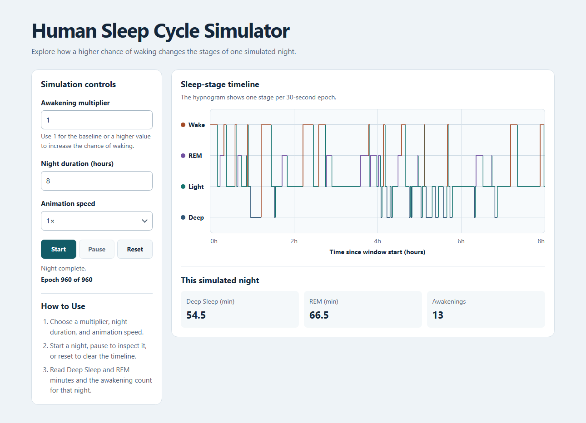
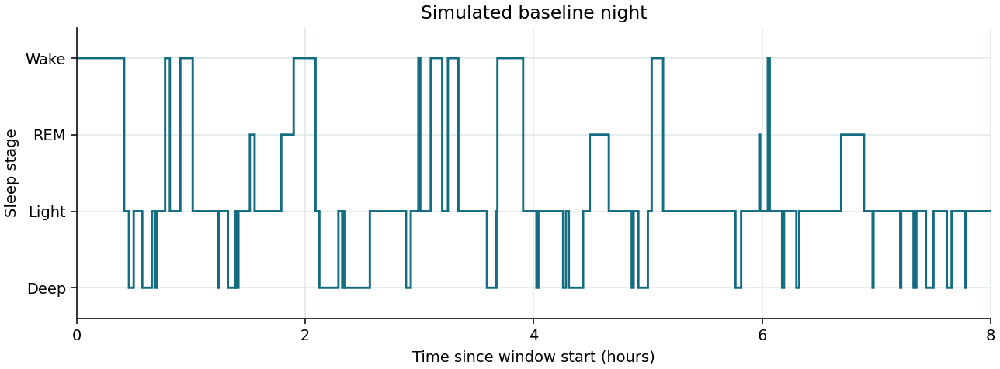
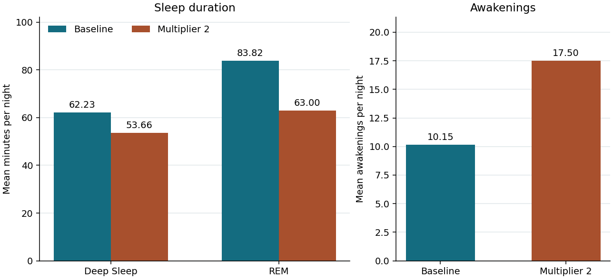

# Human Sleep Cycle Simulator

Explore how more frequent transitions into Wake change simulated sleep, using a Markov chain fitted to real overnight recordings.

[GitHub Pages demo](https://shenalsilvasd.github.io/Human-Sleep-Cycle-Simulator/) · 

The Pages link is the deployment address. The demo also runs locally by opening [docs/index.html](docs/index.html) in a browser.

*Screenshot from a completed local demo run. The readings are for the displayed night.*

## Research question

How does increasing the probability of moving from Light, Deep, or REM sleep into Wake affect Deep Sleep minutes, REM minutes, and awakenings over an eight-hour simulated night? The experiment compares the fitted baseline with a scenario where the three sleep-to-Wake probabilities are doubled. An awakening is a change from a sleep stage into Wake at 30-second resolution.

## Quick start

- **Colab:** Open the notebook with the badge, then select **Runtime → Run all**. The notebook installs its annotation reader and downloads the selected hypnograms automatically. Internet access is needed to fetch dependencies and data.
- **Browser:** Open the Pages link or download and open [docs/index.html](docs/index.html) in a current browser. The demo is self-contained. It uses the fitted probabilities embedded in the page.
- **Local notebook:** From the repository root, use a Python 3.10+ environment with Jupyter Notebook installed. Install the project packages, then open the notebook and run all cells.

~~~bash
python -m pip install -r requirements.txt
jupyter notebook notebook/Human_Sleep_Cycle_Simulator.ipynb
~~~

## Using the demo

Select the awakening multiplier, night duration, and animation speed, then press **Start**. The hypnogram and three metrics show one simulated night. **Pause** freezes playback and **Resume** continues it. **Reset** clears the run and restores the default controls. See the [web demo user guide](USER_GUIDE.md).

## Model and mathematics

The four states are Wake, Light, Deep, and REM. The next stage is sampled from the current stage’s row of a transition matrix. Each baseline probability is the number of observed transitions to that destination divided by the total outgoing transitions from the current stage. The model uses 18 [Sleep-EDF training recordings](data/README.md) and checks one-step behaviour on six recordings from separate participants. Simulations begin at the start of the preprocessed window. All 18 training windows started in Wake.

The intervention multiplies the sleep-to-Wake probabilities and proportionally rescales the remaining probabilities in those rows. The Wake row stays fixed. See [theory and verification](THEORY.md) for the fitted matrix, equations, and statistical method.

## Verification

Notebook checks cover stage mapping, invalid gaps, participant separation, probability bounds and row sums, the multiplier rule, eight-hour duration, and fixed-seed reproducibility. Final paired confidence intervals are checked against SciPy. In a recorded local cross-implementation test, Python and JavaScript matched all 960 stages and all three metrics for each of multipliers 1 and 2 when given the same draws. The held-out comparison found its largest gap in REM persistence, which was 2.21 percentage points lower than in training.

*Notebook output: one seeded baseline night. The plot illustrates the 960-epoch timeline. Duration, stage validity, and reproducibility are checked separately in the notebook.*

## Concepts applied

This project applies empirical categorical probability estimation, discrete-time Markov chains, inverse-transform sampling, paired Monte Carlo simulation with common random numbers, and Student’s t confidence intervals. Participant-level holdout validation compares observed one-step transitions with the fitted probabilities.

## Results

The final experiment used 10,000 paired eight-hour nights with master seed 4042. Differences are multiplier 2 minus baseline. Values are rounded for display.

| Outcome | Baseline mean | Multiplier-2 mean | Mean paired difference | 95% paired CI |
|---|---:|---:|---:|---:|
| Deep Sleep (min/night) | 62.234 | 53.660 | −8.574 | [−8.783, −8.365] |
| REM (min/night) | 83.824 | 62.996 | −20.829 | [−21.192, −20.465] |
| Awakenings/night | 10.147 | 17.498 | +7.351 | [7.300, 7.402] |

## Limitations and future work

The fit pools a small subset and assumes the same transition probabilities throughout the night. It does not account for time already spent in a stage or participant differences. The holdout comparison checks one-step probabilities. The confidence intervals measure simulation uncertainty conditional on the fitted model, and the intervention is hypothetical. Future work could evaluate full-night outcomes on more participants and test time-varying transitions or more flexible stage durations.

## Key references

- [Sleep-EDF Database Expanded, PhysioNet](https://physionet.org/content/sleep-edfx/1.0.0/)
- [Bizzotto et al., Markov chain models of sleep architecture](https://doi.org/10.1208/s12248-011-9287-4)
- [Norris, Markov Chains](https://doi.org/10.1017/CBO9780511810633)

See the [full references](REFERENCES.md).

## AI assistance

OpenAI Codex assisted with development, debugging, testing, and documentation. The project author chose the research question and modelling scope, reviewed the work in stages, and reported testing the browser demo. The notebook contains executable checks and saved results.

## Licence and credits

The project code is distributed under the [MIT License](LICENSE). The fitted model uses annotations from [Sleep-EDF Database Expanded](https://physionet.org/content/sleep-edfx/1.0.0/), available under the [Open Data Commons Attribution License v1.0](https://physionet.org/content/sleep-edfx/view-license/1.0.0/). See the [data notes](data/README.md) for the selected files and reproducible download process.
