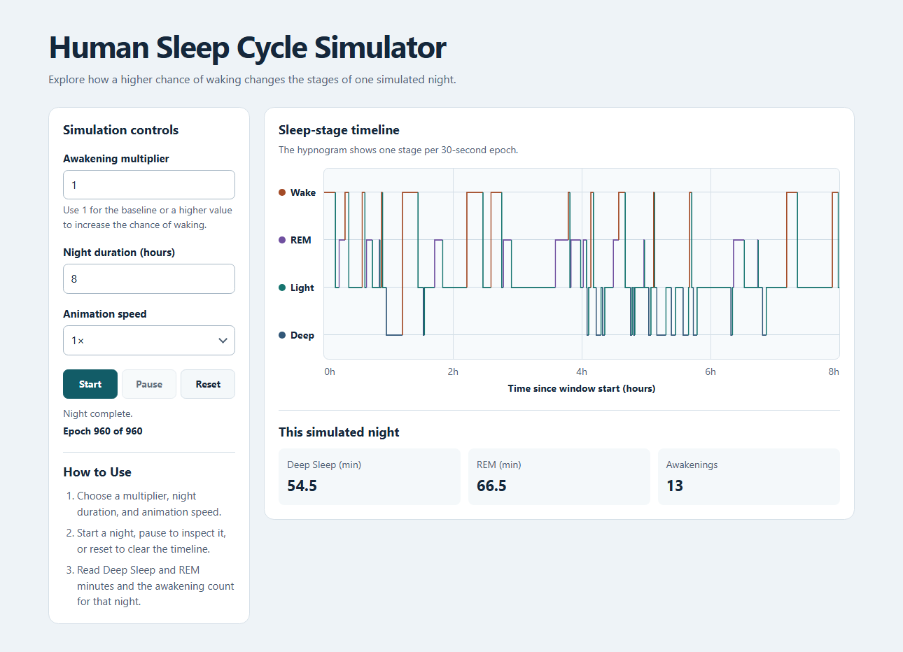

# Web demo user guide

Open the [GitHub Pages demo](https://shenalsilvasd.github.io/Human-Sleep-Cycle-Simulator/) once deployed. To use it locally, open [docs/index.html](docs/index.html) from the downloaded repository in a current browser. It runs entirely in the browser with the fitted model embedded in the page.

*Screenshot from a completed local demo run. The readings are for the displayed night.*

## Controls and playback

| Control | What it does | Default and range |
|---|---|---|
| Awakening multiplier | Scales the chances of moving from Light, Deep, or REM into Wake. The Wake row stays fixed. | **1** for the fitted baseline. Finite values from 1 to the fitted limit of about 64.18. |
| Night duration | Sets the simulated time window. Each half-hour adds 60 epochs. | **8 hours**. Use positive half-hour increments, starting at 0.5 hours. |
| Animation speed | Controls playback rate without resampling the night. You can change it during playback. | **1×**. Options are 0.5×, 1×, 2×, and 4×. |
| Start | Generates a fresh sequence using the selected multiplier and duration, then starts playback. | Available when ready and after completion. |
| Pause / Resume | Stops playback and freezes the readings. Resume continues the same night from the same point. | Available during playback and while paused. |
| Reset | Stops playback, clears the hypnogram, zeros all metrics, and restores the default settings. | Available after a night starts. |

A multiplier or duration edit takes effect on the next **Start**. Invalid multiplier or duration inputs produce a validation message.

## Reading the display

- The **hypnogram** shows one stage per 30-second epoch, with Wake, REM, Light, and Deep from top to bottom. Its horizontal scale shows time since window start, in hours. Tick labels adapt to the simulated duration, including 10.5 hours.
- **Epoch X of Y** gives playback progress. An eight-hour night has 960 epochs. A 10.5-hour night has 1,260.
- **Deep Sleep (min)** and **REM (min)** accumulate 0.5 minutes per matching epoch.
- **Awakenings** counts changes from Light, Deep, or REM into Wake. The initial Wake epoch and successive Wake epochs do not increase this count.

## Try a baseline and an intervention

1. Set the multiplier to **1**, leave duration at **8 hours**, and select **Start**. Try pausing, changing playback speed, and resuming. Wait for **Night complete**.
2. Select **Reset**, set the multiplier to **2**, and select **Start** again. Compare the plot and final readings.
3. Use the [notebook results](README.md#results) to compare average effects. Each browser run samples a new night, so two individual runs can differ in either direction.

## Check against the notebook

A recorded local parity test used the first 960 uniform draws from NumPy’s default generator with seed 4042 in both the notebook simulator and the JavaScript simulator. The tolerance was zero stage mismatches and exact equality of the three metrics. Both implementations met that tolerance.

| Multiplier | Matched stages | Deep Sleep (min) | REM (min) | Awakenings |
|---|---:|---:|---:|---:|
| 1 | 960 of 960 | 76.5 | 31.5 | 9 |
| 2 | 960 of 960 | 66.0 | 28.5 | 19 |

These values describe the fixed-draw test. The demo’s Start button uses fresh browser randomness. The data source and model limitations are described in [the data notes](data/README.md) and [theory](THEORY.md).
